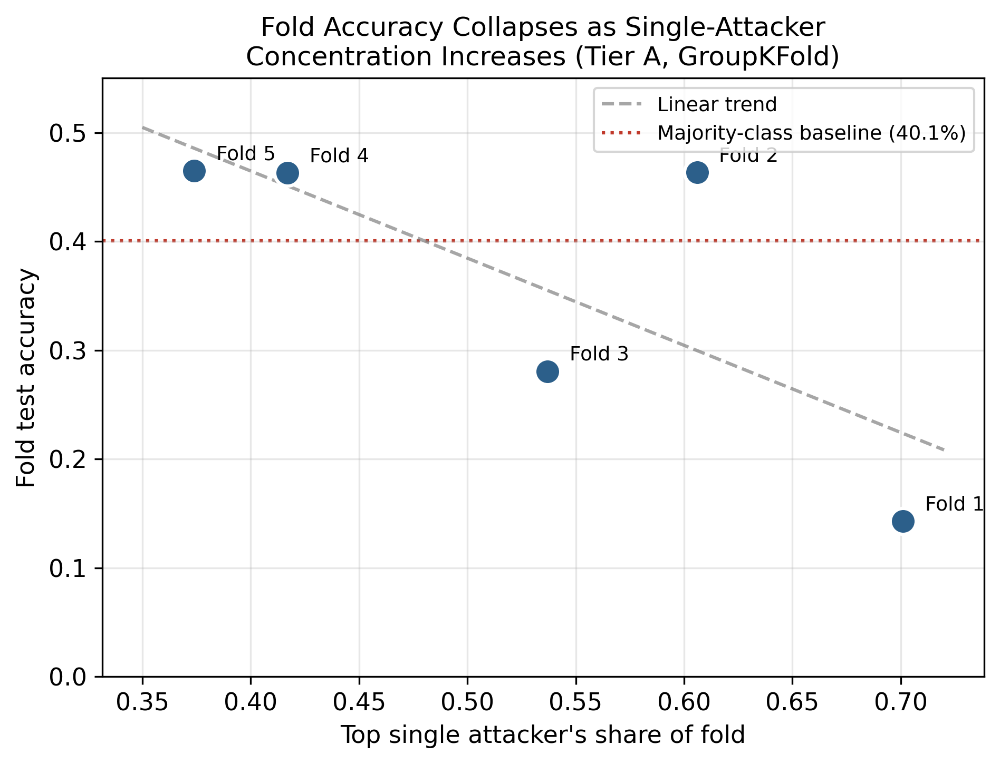
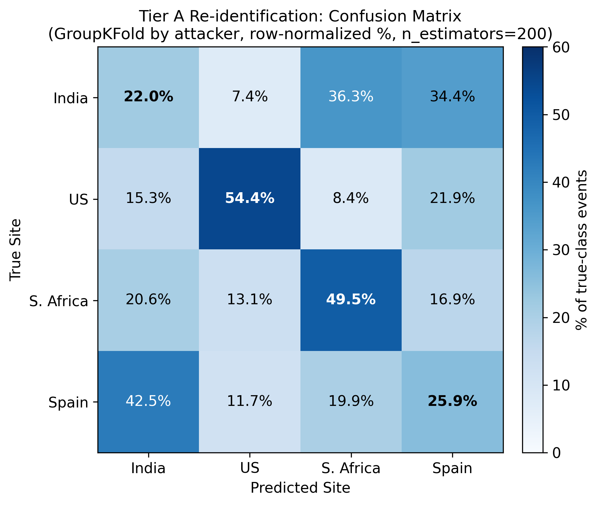
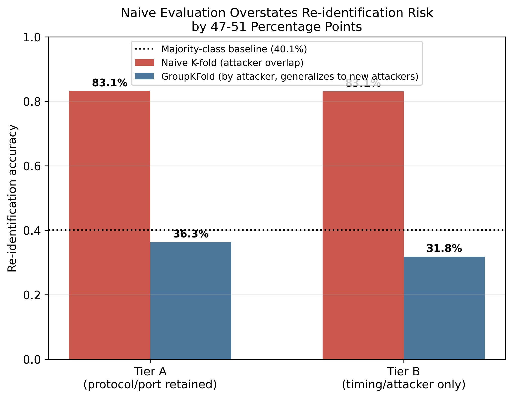
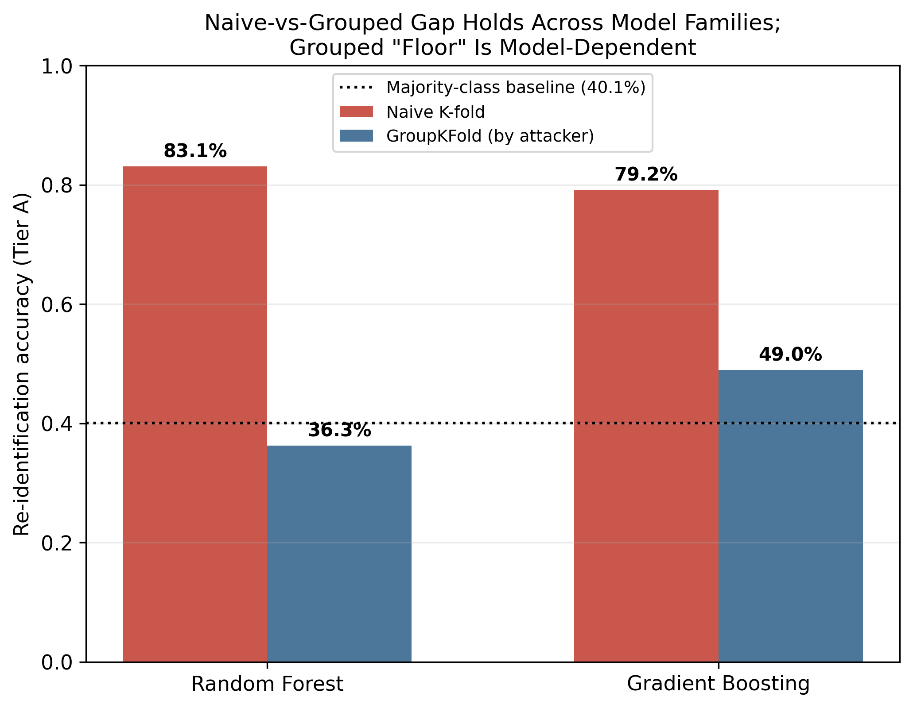

# Naive Evaluation Overstates Re-identification Risk in Shared Honeypot Threat Intelligence: A Methodological Study Using Real Multi-Site Data

**Abhinandan Gavali¹, Manasi Gavali², Irfan Alam³**  
¹School of Computing Science Engineering and Artificial Intelligence, VIT Bhopal University, India  
²[Affiliation to be confirmed]  
³[Affiliation to be confirmed]  
Corresponding author ORCID: 0009-0007-9411-3311

 

## Abstract

Community-scale threat-intelligence sharing, exemplified by the Honey Community model, extends honeypot-based deception beyond a single organization by having participants share anonymized threat data. This model assumes anonymization prevents shared data from revealing which participant generated it — an assumption raised qualitatively in prior work but not, to our knowledge, tested using an evaluation methodology that distinguishes genuine site-level fingerprinting from mere memorization of previously-seen attackers. Using a real, publicly available multi-site honeypot dataset (MURHCAD) spanning four geographically distinct cloud deployments, we train classifiers to re-identify the source site from two anonymized data tiers of increasing strictness. A naive evaluation protocol — standard random cross-validation without attacker-level grouping — suggests strong re-identification capability (83.1% accuracy with a Random Forest against a 40.1% majority-class baseline). An evaluation protocol that holds out attackers entirely unseen during training, reflecting the realistic scenario for a growing threat-sharing community, shows this naive estimate is substantially inflated regardless of model choice: the naive-to-grouped accuracy gap is 46.8 points for Random Forest and 30.2 points for Gradient Boosting. We trace this gap to memorization of individual attacker identities, most pronounced for Random Forest (99.5% training accuracy vs. 37.1% held-out accuracy), and confirm it is systemic across many repeat attackers rather than dependent on any single high-volume outlier. Notably, the two model families disagree on whether genuine site-level signal exceeds a naive baseline once memorization is controlled for — Random Forest's grouped accuracy falls below the majority-class baseline (36.3%), while Gradient Boosting's exceeds it (49.0%) — indicating that conclusions about the *existence* of residual re-identification risk, not just its *magnitude*, can be model-dependent. These results suggest that evaluation methodology, as much as anonymization technique, determines conclusions drawn about privacy risk in shared security data.

**Keywords:** honeypot, threat intelligence sharing, privacy, re-identification, deception, community defense, evaluation methodology

---

## 1. Introduction

Community-scale threat intelligence sharing — in which multiple organizations pool honeypot-derived data to improve collective detection — has been proposed as a way to extend the value of deception-based defense beyond what any single organization can achieve alone. The Honey Community model (Harrison et al., 2015), developed at UTSA's Center for Infrastructure Assurance and Security, exemplifies this approach: participating sites deploy their own honeypots, then share derived threat intelligence with the broader community.

This model depends on an implicit assumption: that data can be anonymized before sharing without exposing which participant generated it. Sokol et al. (2017) questioned this assumption qualitatively, noting that anonymizing and publishing honeypot network traces carries privacy risk even when direct identifiers are removed. However, this concern has not, to our knowledge, been tested empirically using a methodology that distinguishes genuine site-level fingerprinting from a more mundane and less interesting possibility: that a classifier merely memorizes specific high-volume attackers it has already seen, rather than learning a durable property of the site itself.

This distinction matters practically. A threat-sharing community is only useful if it continues to admit new participants and encounters new attackers over time — the realistic evaluation question is not "can we recognize an attacker we've already profiled," but "does shared data reveal a new participant's identity to an adversary examining a genuinely unfamiliar attack." An evaluation methodology that does not account for this distinction risks materially overstating the privacy risk of data sharing, potentially discouraging participation in schemes that are, in practice, safer than a naive analysis would suggest — or conversely, understating a real risk if the wrong methodology happens to look reassuring.

In this paper, we use a real, publicly available multi-site honeypot dataset (MURHCAD) comprising attack telemetry from four geographically distinct deployments to test whether anonymized, shared threat intelligence permits re-identification of the originating site. We construct two anonymization tiers of increasing strictness and evaluate re-identification accuracy under two evaluation protocols: a naive protocol resembling what an evaluation without attacker-generalization awareness would produce, and a grouped protocol that guarantees no attacker's behavior is observed in both training and test data.

Our central finding is that these two protocols produce starkly different conclusions, and that this gap holds regardless of model choice, even though the two model families we test disagree on the more specific question of whether any genuine re-identification signal remains once memorization is controlled for. Naive evaluation suggests strong re-identification capability. Grouped evaluation — which reflects the realistic scenario of encountering new attackers — shows substantially reduced accuracy in both cases, falling below the majority-class baseline for one model (Random Forest) and modestly above it for another (Gradient Boosting). We trace the naive/grouped gap to a concrete mechanism: memorization of specific attacker identities rather than genuine site-level signal, most pronounced for Random Forest, and confirm this finding is systemic rather than dependent on any single extreme-volume attacker.

**Contributions.** This paper contributes: (1) an empirical, rather than qualitative, test of re-identification risk in shared honeypot threat intelligence, using real multi-site data; (2) a demonstration that evaluation methodology materially determines the conclusion drawn about this risk, with naive evaluation overstating it by 30-51 percentage points depending on model and anonymization tier; (3) a cross-model comparison showing this overstatement is not specific to one classifier family, while also showing that whether genuine residual signal exists at all can itself be model-dependent; and (4) a diagnosis of the underlying mechanism that explains why this overstatement occurs and how to detect it in future work.

The remainder of this paper is organized as follows: Section 2 reviews related work in community honeypot deception, threat-intelligence privacy, and re-identification methodology. Section 3 describes the dataset, threat model, anonymization tiers, and evaluation protocol. Section 4 presents results. Section 5 discusses implications and limitations. Section 6 concludes.

---

## 2. Related Work

### 2.1 Community-Scale Honeypot Deception and Threat Sharing

The concept of extending honeypot deception beyond a single organization to a coordinated, multi-participant model was formalized by Harrison, Rutherford, and White (2015), whose Honey Community concept, developed through CIAS, proposed combining honeypot-derived data across multiple organizations within a shared geographic or sectoral boundary to improve collective threat detection. This work established the operational template this paper builds on: participants deploy their own honeypots, then share derived threat intelligence with the community rather than raw infrastructure data.

Public, multi-site honeypot datasets that could support this kind of community model have since become more available. The Multi-Regional Cloud Honeynet Dataset (MURHCAD) (Feito-Casares et al., 2025/2026) — the dataset used in this study — captures real attack traffic across four geographically distinct cloud deployments using a standardized multi-honeypot platform (T-Pot, combining Cowrie, Dionaea, and SentryPeer). Related efforts, including the Hornet 40 and CTU Hornet 65 Niner datasets (Valeros and García), similarly collect low-interaction honeypot telemetry across geographically distributed sensors, reflecting a broader trend toward standardized, shareable honeypot telemetry as infrastructure for community-scale defense. This trend sits within a broader, active honeypot research landscape; Javadpour et al. (2024) survey cyber deception techniques for improving honeypot performance more generally, cataloguing the wide range of approaches this field has produced.

### 2.2 Privacy Risks in Threat Intelligence Sharing

Community threat-sharing models depend on the assumption that shared data can be adequately anonymized before exchange. Broader work on threat-intelligence privacy has questioned this assumption: sharing raw indicators risks exposing sensitive information about the reporting organization, and conventional anonymization schemes have repeatedly been shown insufficient once an adversary combines the shared data with auxiliary external knowledge. This concern is not specific to honeypot data — it reflects a general pattern in security-relevant data sharing wherever participant confidentiality and collective defense value are in tension. Wang et al. (2024) illustrate this same tension in a different domain, showing that UAVs participating in collaborative honeypot defense are often reluctant to share captured attack data without adequate incentives, precisely because such sharing risks exposing sensitive configuration and operational information — the same structural conflict this paper investigates empirically in a cloud-honeypot context.

Honeypot data sharing has been flagged as a specific instance of this broader concern. Sokol, Mísek, and Husák (2017), discussing privacy issues in honeypot and honeynet operation, raised the anonymization problem in sharing and publishing honeypot network traces directly, motivating the scientific and operational case for sharing this data while noting the associated privacy risk qualitatively. This paper's contribution can be read as a direct, quantitative follow-up to that qualitative concern: where prior work identified the risk conceptually, this study measures whether — and how much — it materializes in practice, and under what evaluation conditions.

### 2.3 Evaluation Methodology and Data Leakage in Machine Learning

This paper's central methodological concern — that naive cross-validation can produce overoptimistic results when correlated samples (here, many events from the same attacker) are split across training and test sets — is not new to machine learning generally, though it has not, to our knowledge, been previously examined in the honeypot threat-sharing context. Kapoor and Narayanan (2023) surveyed the broader reproducibility literature and found data leakage affecting at least 294 papers across 17 scientific fields, frequently producing wildly overoptimistic conclusions later overturned by leakage-aware re-evaluation. Sasse et al. (2023) provide a systematic taxonomy of leakage scenarios in ML pipelines, including the specific pattern this paper investigates: correlated or repeated entities (here, attackers; elsewhere, patients or subjects) appearing in both training and test data.

This pattern has been documented across domains structurally similar to ours. Albzour (2026) demonstrates it directly: random image-level splitting on a leukemia-detection dataset inflates reported accuracy relative to a strict subject-disjoint protocol, using the same "compare naive against grouped splitting on identical models" structure this paper adopts. Most directly relevant to our domain, Soltaniani and Ghafari (2026) show that duplicated or highly similar samples split across training and test sets can substantially inflate the reported performance of ML-based secret-detection models — a security application, like ours, where overoptimistic evaluation directly risks misleading practitioners about real-world tool effectiveness. This paper extends this general methodological concern, previously demonstrated in medical imaging, software security, and other domains, to honeypot threat-intelligence privacy specifically — a domain where, to our knowledge, this evaluation pitfall has not yet been examined.

### 2.4 Re-identification and Linkage-Attack Methodology

The general methodology of re-identifying a data source from supposedly anonymized records — by exploiting residual, indirect signal that survives direct-identifier removal — is well established in privacy research outside the security domain. Sweeney's (2002) k-anonymity model formalized the conditions under which a released dataset resists re-identification, and remains the reference point against which most subsequent anonymization schemes are measured. Narayanan and Shmatikov (2008) demonstrated the limits of such schemes empirically, showing that an adversary with only modest auxiliary knowledge could re-identify individuals in the anonymized Netflix Prize dataset — a foundational demonstration that anonymization alone, without accounting for an adversary's side information, is frequently insufficient. More recent linkage-attack approaches have extended this template to anonymized health records and text documents, typically by training a classifier or matching algorithm to exploit auxiliary correlates that remain after direct identifiers are stripped. This study adapts this general linkage-attack template to the honeypot threat-sharing context, using a Random Forest classifier trained on residual behavioral and timing signal to attempt site re-identification, rather than inventing a new attack methodology from scratch.

### 2.5 Positioning This Work

This study differs from prior work in two respects. First, unlike the qualitative treatment of honeypot privacy risk in earlier literature, we provide a direct empirical measurement using a real, multi-site dataset and a concrete re-identification model. Second, and more significantly, we show that the evaluation protocol used to measure this risk materially determines the conclusion: a naive, non-attacker-aware evaluation substantially overstates re-identification risk relative to an evaluation that properly holds out unseen attackers. This second point is an instance of a general pattern — entity-level leakage inflating reported performance — well documented elsewhere in machine learning (Section 2.3), but to our knowledge not previously demonstrated specifically in the honeypot threat-sharing privacy literature, where qualitative risk claims have so far gone untested against this failure mode.

---

## 3. Methodology

### 3.1 Dataset

This study uses MURHCAD, a real, publicly available dataset comprising 132,425 attack events captured by three honeypot services — Cowrie, Dionaea, and SentryPeer — deployed via T-Pot across four geographically distinct Azure regions: Central India, Central US, South Africa North, and Spain Central, over a continuous 72-hour collection window. Each record includes destination hostname, source/destination IP and geolocation, ASN/organizational attribution, targeted port, protocol, attack type, and timestamp-derived fields.

`dstHostname` provides a genuine, publicly documented ground-truth label identifying which regional site captured each event. We treat each deployment as an analogue for a distinct threat-sharing community participant, while acknowledging (Section 5) that these four sites represent one research group's deployment rather than four independent organizations. Dataset integrity was validated against statistics reported in the original MURHCAD publication (total event count, top source IP and count, unique source-country count all matched exactly) prior to use.

### 3.2 Threat Model

We model a threat-sharing community in which participating sites exchange anonymized threat intelligence. The adversary is a party with access to this shared feed who attempts to infer which specific site generated a given record, despite removal of direct identifiers.

### 3.3 Anonymization Tiers

**Removed in both tiers:** `dstIp`, `dstIpInternal`, `dstGeoIp`, `dstLat`, `dstLon`, `dstCountryName`.

**Tier A (naive anonymization):** retains `hour`, `day`, `weekday`, `srcPort`, `srcOrg`, `srcCountryName`, `srcLat`, `srcLon`, `dstPort`, `protocol`, `attackType`.

**Tier B (aggressive anonymization):** additionally removes `dstPort`, `protocol`, `attackType`, retaining only timing and attacker-context fields.

The ground-truth `dstHostname` label was retained separately for evaluation only, never among model features.

### 3.4 Re-identification Models

A Random Forest classifier (Breiman, 2001; scikit-learn implementation, 200 estimators for all reported headline results) was trained to predict `dstHostname`. Categorical features were one-hot encoded; high-cardinality `srcOrg` and `srcCountryName` were bucketed to their 30 and 20 most frequent values respectively, with remainder grouped as "OTHER." A `class_weight='balanced'` variant was additionally tested to rule out class-imbalance effects.

To test whether findings were specific to Random Forest's particular inductive bias, we additionally trained a Gradient Boosting classifier (Friedman, 2001; scikit-learn, 50-100 estimators, max depth 3) on both tiers under both evaluation protocols, using identical features and folds.

### 3.5 Evaluation Protocol

**Naive evaluation:** standard 5-fold cross-validation with random shuffling.

**Grouped evaluation:** 5-fold GroupKFold, grouping all events by `srcIp` so no attacker's events span both train and test within a fold. This design follows the general "entity-disjoint" evaluation principle established in the broader ML leakage literature (Sasse et al., 2023; Kapoor and Narayanan, 2023) and applied to structurally similar problems elsewhere (e.g., subject-disjoint evaluation in Albzour, 2026), adapted here to attacker identity as the relevant entity.

We report accuracy against uniform-random (25%) and majority-class (40.1%) baselines, plus top-2 accuracy, per-class precision/recall/F1, and 95% bootstrap confidence intervals (1,000 iterations, following Efron's 1979 bootstrap resampling method) for grouped evaluation. We compared in-fold training vs. held-out test accuracy to diagnose overfitting, examined correlation between fold accuracy and single-attacker concentration, and repeated the naive-vs-grouped comparison excluding the single highest-volume attacker as a robustness check.

---

## 4. Results

### 4.1 Naive Row-Level Analysis Suggests Strong Site Fingerprinting

Initial exploratory analysis revealed apparently strong protocol/service fingerprints per site: `vm-centralus` was 80.0% SMB traffic; `vm-centralindia` was 63.3% SIP and 28.6% Telnet; `vm-spaincentral` was 80.6% SIP; `vm-southafricanorth` showed the most balanced distribution. Under naive 5-fold cross-validation, the Random Forest classifier achieved 83.1% accuracy on both Tier A and Tier B — well above the 40.1% majority-class baseline.

### 4.2 This Signal Does Not Generalize to Unseen Attackers

Under GroupKFold evaluation (grouping by attacker IP), Random Forest accuracy collapsed to 36.3% (Tier A) and 31.8% (Tier B) — both below the majority-class baseline. Once genuinely novel attackers are held out, neither anonymization tier supports reliable site re-identification with this model.

### 4.3 Diagnosing the Gap: Memorization, Not Generalization

Training accuracy averaged 99.5% across GroupKFold folds, versus 37.1% held-out test accuracy (with class balancing applied, ruling out imbalance as the cause) — consistent with memorization of attacker-specific feature combinations rather than a durable site signature. Fold-level accuracy ranged from 14.3% to 46.5%, correlating directly with the concentration of any single high-volume attacker within a fold (Figure 2); the worst fold (14.3%) had one attacker IP comprising 70.1% of test events.

The confusion matrix (Figure 1) reveals an asymmetric pattern: `vm-spaincentral` is predominantly confused with `vm-centralindia` (42.5% of true Spain events), while `vm-centralindia` splits almost evenly between `vm-southafricanorth` (36.3%) and `vm-spaincentral` (34.4%). `vm-centralus` remains most reliably identified (54.4% recall), `vm-southafricanorth` second (49.5%).

### 4.4 Quantifying the Overstatement

Direct naive-vs-grouped comparison showed gaps of 46.8 points (Tier A) and 51.3 points (Tier B) for Random Forest (Figure 3). Mean attacker-IP overlap between naive train/test splits was 98.7%. Notably, Tier A and Tier B produced nearly identical naive accuracy (83.12% vs. 83.08%) despite Tier B's removal of protocol/port data — the naive methodology cannot distinguish between anonymization schemes, since it is not measuring genuine behavioral signal. Only grouped evaluation shows the tiers diverging meaningfully.

Excluding the single highest-volume attacker (14.0% of all events) reduced naive accuracy only modestly (83.1% to 80.3%), confirming the overstatement is systemic rather than dependent on one outlier.

### 4.5 Cross-Model Robustness Check: Gradient Boosting

To test whether the above findings were specific to Random Forest, we repeated the naive-vs-grouped comparison on both tiers using Gradient Boosting. The direction of the core finding held in both cases: naive evaluation substantially exceeded grouped evaluation (Tier A: 79.2% vs. 49.0%, a 30.2-point gap; Tier B: 78.3% vs. 34.6%, a 43.7-point gap), confirming that evaluation methodology matters regardless of model family or anonymization tier.

The two models agree that Tier B's grouped accuracy falls below the 40.1% majority-class baseline (Random Forest: 31.8%; Gradient Boosting: 34.6%). They disagree specifically on Tier A: Random Forest's grouped accuracy (36.3%) falls below baseline, while Gradient Boosting's (49.0%) exceeds it (Figure 4). This divergence is isolated to the tier that retains protocol/port information, suggesting it reflects real, if modest, signal in that richer feature set that Random Forest's heavier memorization obscures and Gradient Boosting partially recovers — rather than a generic disagreement between the models across all conditions. This tracks a difference in memorization behavior: Gradient Boosting's mean training accuracy across GroupKFold folds was 80.0% (Tier A) and 79.4% (Tier B), compared to Random Forest's 99.5% — Gradient Boosting overfits considerably less. Examining identical held-out folds across both models on Tier A makes this concrete: the fold with the least single-attacker concentration produced 46.3% accuracy under Random Forest but 71.9% under Gradient Boosting on the exact same held-out attackers — a difference attributable to the model, not the data split.

### 4.6 Summary

| Evaluation | RF Tier A | RF Tier B | GBoost Tier A | GBoost Tier B | Majority baseline |
|---|---|---|---|---|---|
| Naive K-fold | 83.1% | 83.1% | 79.2% | 78.3% | 40.1% |
| GroupKFold (by attacker) | 36.3% | 31.8% | 49.0% | 34.6% | 40.1% |
| Overstatement | 46.8 pts | 51.3 pts | 30.2 pts | 43.7 pts | — |

---

## 5. Discussion and Limitations

### 5.1 Implications

Claims about privacy risk in shared security data are only as trustworthy as the evaluation protocol used to produce them. A naive evaluation can suggest strong re-identification capability even when a more realistic evaluation shows the same data supports considerably less. Organizations auditing threat-sharing participation risk should explicitly confirm whether such audits account for attacker overlap between test data and realistic new-attacker scenarios.

A second, less expected implication follows from the cross-model comparison: whether residual re-identification risk exists at all, not just its magnitude, can depend on model choice. A privacy audit that tests only one classifier family risks a false negative (Random Forest here fell below baseline, suggesting no reliable signal) as easily as a false positive (naive evaluation's inflated numbers). This argues for testing multiple model families as standard practice in this kind of privacy audit, not as an optional robustness check.

The asymmetric India/Spain confusion pattern is observable but not fully explained by this dataset alone; plausible explanations include overlapping attacker populations or coincidental similarity within this specific 72-hour window, but distinguishing between these requires data beyond this study's scope.

### 5.2 Limitations

**Single research group's deployment, not independent organizations.** The four sites represent one group's multi-region deployment, not independent real-world organizations. Whether findings generalize to genuinely independent participants — who may differ more substantially than four regions of one deployment — remains open.

**Short collection window.** 72 hours captures substantial real traffic but cannot capture longer-term drift or a threat-sharing community's evolving composition.

**Model coverage is still partial.** We tested two model families (Random Forest, Gradient Boosting) across both anonymization tiers. They agree that Tier B's grouped accuracy falls below baseline, but disagree on Tier A specifically — a divergence isolated to the richer feature set, which we interpret as evidence of real but modest signal that Random Forest's heavier memorization obscures. We do not have a full theoretical account of this divergence beyond the observed difference in memorization behavior (training accuracy), and we did not tune either model's hyperparameters or test a third architecture (e.g., a neural network) that might reveal a third distinct outcome. With only two models compared, we cannot say which is closer to a "ground truth" answer about genuine residual risk in Tier A specifically — only that the answer is not settled by Random Forest alone, which is itself the more important methodological point.

**Class imbalance and site count.** With four sites (11.3%-40.1% of events), statistical power for the smallest class is limited relative to the largest.

**Scope of anonymization tested.** Only two specific schemes were tested; these do not exhaust the space of reasonable anonymization choices. Source-side attacker attributes were retained in both tiers as legitimate shared intelligence; a scheme removing these was not tested.

**Single dataset family.** Replication using an independent dataset (e.g., Hornet 40 or CTU Hornet 65 Niner, identified but not incorporated here) would strengthen confidence that findings are not specific to this deployment.

---

## 6. Conclusion

This paper presented an empirical test of re-identification risk in community-scale honeypot threat-intelligence sharing, using real multi-site data. Our central finding is that evaluation methodology, not just anonymization technique or model choice, determines the conclusion drawn about privacy risk: naive evaluation overstated re-identification accuracy by 30-51 percentage points relative to grouped evaluation, across two different classifier families. We traced this overstatement to a concrete, verifiable mechanism — memorization of individual attacker identities, more pronounced in Random Forest than Gradient Boosting — and confirmed it is not dependent on any single extreme-volume attacker. A secondary finding complicates a fully clean narrative: the two model families disagreed on whether genuine residual re-identification signal exists once memorization is controlled for, with Random Forest falling below and Gradient Boosting exceeding the majority-class baseline on identical held-out data. We consider this a strength of the study's rigor rather than a weakness to be hidden — it demonstrates that single-model privacy audits risk an incomplete picture in either direction. We recommend that future privacy evaluations of shared security telemetry explicitly report whether train/test splits account for entity-level overlap, and test more than one model family before drawing conclusions about the presence or absence of residual risk. Future work should extend this evaluation to genuinely independent participating organizations, additional model architectures, and longer collection windows.

---

## References  
1. **Harrison, K., Rutherford, J.R., & White, G.B. (2015).** The Honey Community: Use of Combined Organizational Data for Community Protection. *2015 48th Hawaii International Conference on System Sciences (HICSS)*, pp. 2288–2297. DOI: 10.1109/HICSS.2015.274.  

2. **Feito Casares, E., Gómez-Talal, I., & Rojo-Álvarez, J.L. (2025).** Multi-regional Honeynet Dataset: A Distributed T-Pot Honeypot Deployment Across Azure Regions for Cyber Threat Analysis. *arXiv:2601.05813.* 
3. **Sokol, P., Mísek, J., & Husák, M. (2017).** Honeypots and honeynets: issues of privacy. *EURASIP Journal on Information Security*, 2017, pp. 1-9. DOI: 10.1186/s13635-017-0057-4.  
4. **Valeros, V., & García, S. (2022).** Hornet 40: Network dataset of geographically placed honeypots. *Data in Brief*, 40, 107795.  
5. **Valeros, V., & García, S. (2025).** CTU Hornet 65 Niner: A network dataset of geographically distributed low-interaction honeypots. *Data in Brief*, 58, 111261.  
6. **Sedraoui, B.K., Benmachiche, A., Makhlouf, A., & Chemam, C. (2026).** Exploring the Integration of Differential Privacy in Cybersecurity Analytics: Balancing Data Utility and Privacy in Threat Intelligence. *arXiv:2601.00385.*  

7. **Wang, Z., Khatibi, E., Firouzi, F., Mousavi, S.R., Chakrabarty, K., & Rahmani, A.M. (2025).** Linkage Attacks Expose Identity Risks in Public ECG Data Sharing. *arXiv:2508.15850.*  
8. **Manzanares-Salor, B., Sánchez, D., & Lison, P. (2024).** Evaluating the disclosure risk of anonymized documents via a machine learning-based re-identification attack. *Data Mining and Knowledge Discovery*, 38(6), 4040-4075. DOI: 10.1007/s10618-024-01066-3.  

9. **Javadpour, A., Ja'fari, F., Taleb, T., Shojafar, M., & Benzaïd, C. (2024).** A comprehensive survey on cyber deception techniques to improve honeypot performance. *Computers & Security*, 140, Article 103792. DOI: 10.1016/j.cose.2024.103792.  

10. **Wang, Y., Su, Z., Benslimane, A., Xu, Q., Dai, M., & Li, R. (2024).** Collaborative honeypot defense in UAV networks: a learning-based game approach. *IEEE Transactions on Information Forensics and Security*, 19, 1963-1978.  

11. **Kapoor, S., & Narayanan, A. (2023).** Leakage and the reproducibility crisis in machine-learning-based science. *Patterns*, 4(9), 100804. DOI: 10.1016/j.patter.2023.100804.  

12. **Sasse, L., Nicolaisen-Sobesky, E., Dukart, J., Eickhoff, S.B., Götz, M., Hamdan, S., Komeyer, V., Kulkarni, A., Lahnakoski, J., Love, B.C., Raimondo, F., & Patil, K.R. (2023).** On Leakage in Machine Learning Pipelines. *arXiv:2311.04179.*  
13. **Albzour, N. (2026).** A Leakage-Aware Comparative Benchmark of Machine Learning, Deep Learning, and Transformer Models for Reliable Leukemia Detection. *arXiv:2606.24944.*  
14. **Soltaniani, F., & Ghafari, M. (2026).** From Data Leak to Secret Misses: The Impact of Data Leakage on Secret Detection Models. *arXiv:2601.22946.*  

15. **Sweeney, L. (2002).** k-Anonymity: A Model for Protecting Privacy. *International Journal of Uncertainty, Fuzziness and Knowledge-Based Systems*, 10(5), 557-570. DOI: 10.1142/S0218488502001648.  
16. **Narayanan, A., & Shmatikov, V. (2008).** Robust De-anonymization of Large Sparse Datasets. *Proceedings of the 2008 IEEE Symposium on Security and Privacy (SP)*, 111-125. DOI: 10.1109/SP.2008.33.  

17. **Breiman, L. (2001).** Random Forests. *Machine Learning*, 45(1), 5-32. DOI: 10.1023/A:1010933404324.  
18. **Friedman, J.H. (2001).** Greedy Function Approximation: A Gradient Boosting Machine. *The Annals of Statistics*, 29(5), 1189-1232. DOI: 10.1214/aos/1013203451.  
19. **Efron, B. (1979).** Bootstrap Methods: Another Look at the Jackknife. *The Annals of Statistics*, 7(1), 1-26. DOI: 10.1214/aos/1176344552. 
